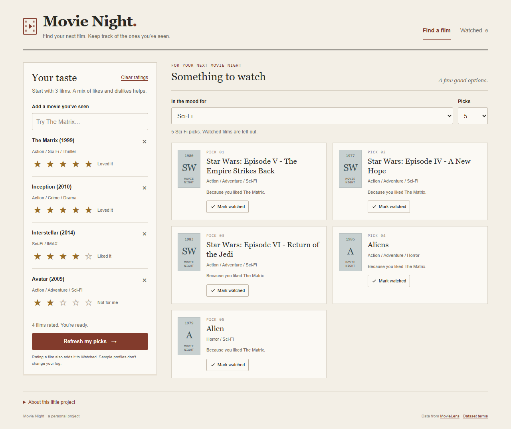
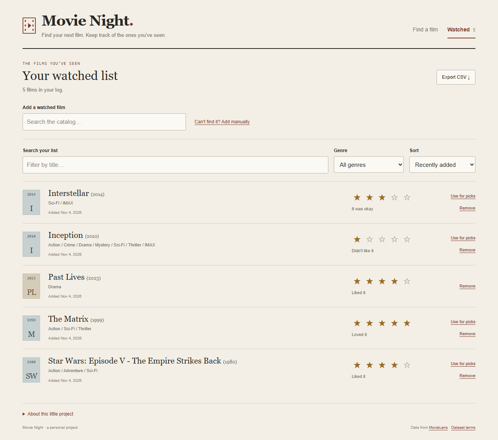

# Movie Night

Rate a few films and get five or ten suggestions for what to watch next. Keep a watched list alongside your recommendations, with your ratings, search, and a CSV export.



## Open the app

Extract the full project folder, then open **`web/index.html`** in a browser. The app and trained model are included, so nothing needs to be installed for the demo. Keep the files together.

1. Search for a movie you've seen and choose its star rating.
2. Rate at least three movies, including one you liked.
3. Choose a genre if you want, then select **Find my next film**.

The sample profiles are there for a quick trial. They do not add films to your watched list. Your own ratings and watched history stay in browser storage.

## Keep a watched list

- Click **Mark watched** on a suggestion to save it and leave it out of future picks. Use **Undo** if you clicked by mistake.
- Open **Watched** to see the full list. Search for films you've seen, change their star ratings, filter by genre, or sort the list.
- Use **Add manually** for recent releases or films missing from the catalog. These entries are for your log; they do not train the recommender.
- Rating a catalog film in **Your taste** also logs it. **Use for picks** copies a watched catalog film into your recommendation profile, which holds up to ten films.
- **Clear ratings** clears only that profile. Your watched history stays saved. Removing a film from Watched also offers Undo.
- **Export CSV** downloads the full watched list, including films hidden by the current filters. The date shown is when you added the entry, not a claimed viewing date.



Storage belongs to this browser and this page location. Keep using the same extracted folder; a different browser or location may have a separate list. Clearing browser data removes the saved list. Export CSV for a backup; CSV import and account syncing are not included. Earlier saved "seen" movies are carried into Watched without inventing dates for them.

## How the suggestions work

The model compares how MovieLens viewers rated different films. Movies with similar rating patterns become neighbors. Your high ratings add support to related movies, and low ratings reduce it. The app removes films you've rated or marked seen before showing results.

Each suggestion names the liked film contributing the most support. A rating-quality term supplies a fallback when there is little personal evidence. The explanations describe the model's input; they do not guarantee that you will enjoy a movie.

The catalog is historical, with ratings through September 2018. It supports 3,650 movies with at least five ratings; 2,269 have the ten ratings required to appear in recommendations. Recent releases may be missing.

## Evaluation

The model was compared with two simple baselines using users kept out of training. After five profile ratings, it returned an average of **2.65 known later favorites in its first ten suggestions** for 52 eligible test users. The most-rated baseline returned **2.85**. Personalization did not outperform that baseline in this small test. See [EVALUATION.md](EVALUATION.md) for the split, tuning, and limits.

This is a useful point to discuss: with very little information about a new user, popular titles are a strong baseline. The live app also gives the user explicit genre control and lets them remove seen movies.

## Rebuild the model

Python 3.12 was used with the versions in `requirements.txt`.

```bash
python -m venv .venv
# Activate the environment for your shell.
pip install -r requirements.txt
python download_data.py
python -m unittest discover -s tests -v
python build_model.py
```

The included dataset is checked against a pinned SHA-256 checksum. `build_model.py` reruns evaluation and exports `web/data.js`. To rebuild only the final browser model using the saved parameters, run `python build_model.py --skip-evaluation`.

Browser tests are optional and require Node.js:

```bash
npm install
npx playwright install chromium
npm run test:browser
```

These checks compare browser rankings with Python reference profiles and exercise search, ratings, watched-list persistence, filters, Undo, manual entries, CSV export, migration of older saves, and mobile layouts. They write `results/browser_checks.json`.

## Files

| File | Purpose |
|---|---|
| `web/index.html`, `style.css`, `app.js` | Browser interface and recommendation logic. |
| `web/data.js` | Trained neighbor graph, movie catalog, and example profiles. |
| `src/recommender.py` | Python model fitting and ranking. |
| `movie_stats.sql` | Movie-level counts and mean ratings. |
| `build_model.py` | User-level evaluation and browser-model export. |
| `tests/test_recommender.py` | Tests for seen exclusions, dislikes, genres, and explanations. |
| `results/evaluation.json` | Measured validation and test results. |
| `results/browser_parity.json` | Reference profiles for checking browser/Python agreement. |

## Data

MovieLens small contains 100,836 ratings from 610 users. It is a development snapshot, pinned here to a specific downloaded file for reproducibility. Ratings are self-selected and do not cover every movie or every kind of viewer.

Source: F. Maxwell Harper and Joseph A. Konstan (2015), [The MovieLens Datasets: History and Context](https://doi.org/10.1145/2827872). [Dataset page](https://grouplens.org/datasets/movielens/latest/).

The source data and transformations are distributed under the original MovieLens research terms in [DATA_LICENSE.txt](DATA_LICENSE.txt). These terms require attribution and permission for commercial use. This project is independent of GroupLens.
